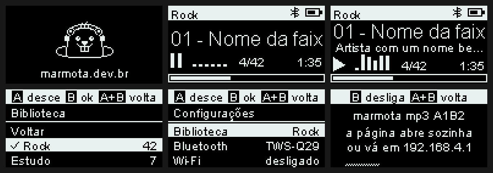
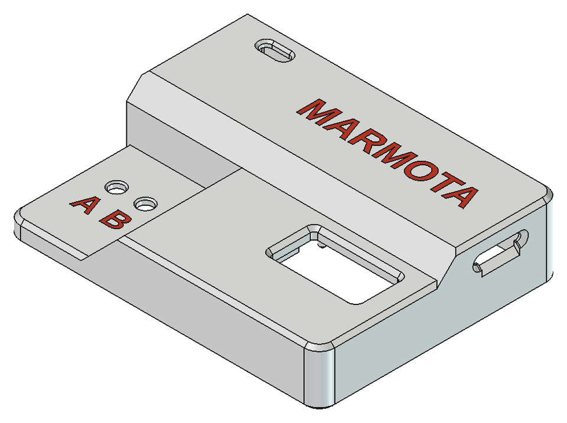
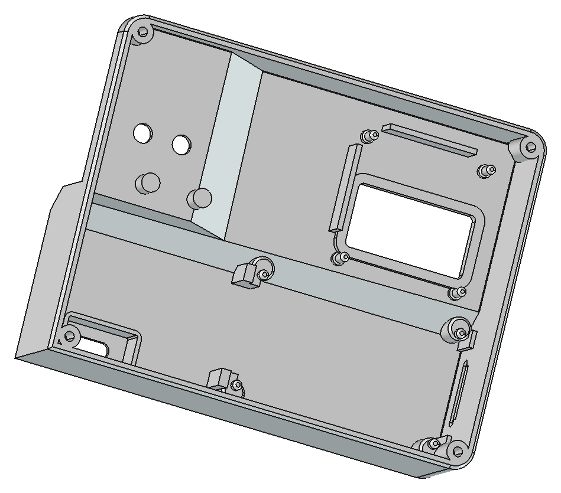
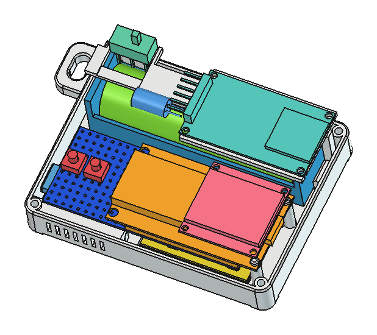
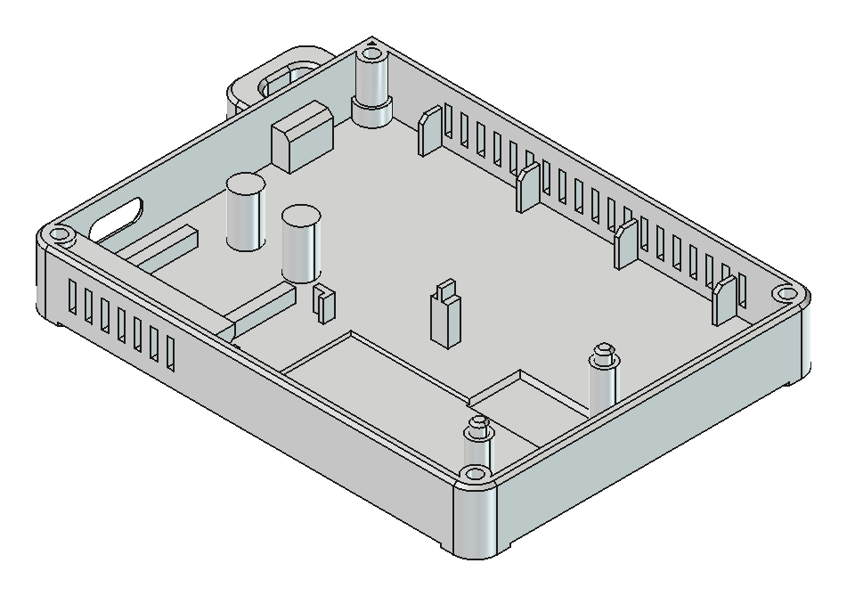

# mp3

Player de MP3 de bolso. Toca os arquivos de um cartão microSD em um fone Bluetooth. Sem loja, sem streaming, sem conta.

Faz parte do projeto [marmota](https://github.com/gustavosilveiragss/marmota).

## Como funciona

- Os MP3 ficam num cartão microSD em FAT32. Uma pasta por playlist, as faixas tocam em ordem de nome.
- O som sai só por Bluetooth (A2DP). Não tem DAC, amplificador nem saída de fone.
- Para enviar músicas, o player abre um Wi-Fi sob demanda. Você conecta o celular, abre a página e envia os arquivos. Wi-Fi e Bluetooth nunca ficam ligados juntos.
- Dois botões e uma tela OLED. A tela tem português e inglês.
- Guarda a posição da faixa e mostra o artista da tag ID3.

## Peças

| Peça | Observação |
|---|---|
| ESP32 devkit clássico | dois núcleos, o C3 e o S3 não fazem A2DP |
| Módulo microSD | armazena a biblioteca |
| Cartão microSD | |
| OLED SSD1306 0,96" I2C | faixa e playlist |
| MT3608 | 3,7 V para 5 V |
| Botões 6x6 (2) | |
| Célula 18650 | |
| Suporte para 18650 | |
| TP4056 USB-C | carregador com proteção |
| Chave SS-12D00 | liga e desliga |
| Resistores, capacitores, fios | |
| Placa perfurada | |
| Barras de pinos fêmea | soquete do ESP |
| Filamento PLA | case |

A montagem é em placa perfurada, sem PCB própria.

## Tela



Abertura, tocando (sem e com artista), biblioteca, configurações e envio de músicas.

## Controles

| Gesto | Ação |
|---|---|
| A toque | play e pausa |
| A toque duplo | faixa anterior |
| A segurar | volume menos |
| B toque | modo busca na faixa |
| B toque duplo | próxima faixa |
| B segurar | volume mais |
| A+B toque | próxima playlist |
| A+B segurar 1,5 s | abre a Config (Wi-Fi, Bluetooth, idioma) |

## Enviar músicas

1. Segure A+B por 1,5 s para abrir a Config.
2. Ligue o Wi-Fi.
3. Conecte o celular na rede `marmota mp3` seguida de 4 caracteres, que aparecem na tela. A página abre sozinha, ou entre em `http://192.168.4.1`.
4. Envie os MP3 e organize as playlists.

Wi-Fi e Bluetooth são exclusivos: abrir o portal desliga o Bluetooth.

## Metadados

O player não busca nada na internet. O que aparece na tela vem do próprio arquivo:

- **Título:** o nome do arquivo, sem a extensão.
- **Artista:** a tag ID3 do MP3 (`TPE1`, ID3v2.3 ou 2.4, com ID3v1 como reserva). Sem tag, o campo fica vazio.
- Só aparecem corretamente os caracteres Latin-1. O resto vira `?`.

Então a tag tem que estar gravada no arquivo antes de ele ir para o cartão. Se o MP3 veio sem tag, grave com o [Mp3tag](https://www.mp3tag.de/), o [Kid3](https://kid3.kde.org/) ou o [MusicBrainz Picard](https://picard.musicbrainz.org/). Alguns sites de download já entregam o arquivo com as tags, então vale conferir antes de copiar.

## Firmware

Precisa de PlatformIO 6.2. O ambiente é `mp3` (Arduino 3.x pelo pioarduino).

```
cd firmware
pio run -e mp3
pio run -e mp3 -t upload
```

O `firmware.bin` tem que caber na partição `app0` (2.359.296 bytes). Se passar disso, o aparelho não inicia.

Bibliotecas, com versão fixa no `platformio.ini`: [marmota-fmk](https://github.com/gustavosilveiragss/marmota-fmk), [ESP32-A2DP](https://github.com/pschatzmann/ESP32-A2DP) e [arduino-libhelix](https://github.com/pschatzmann/arduino-libhelix).

## Case

Os arquivos ficam em `cad/`:

- `marmota.FCStd`: FreeCAD 1.1. Base, tampa, letras e ponte, mais as réplicas dos componentes. As cotas ficam todas na planilha.
- `marmota-assembly.FCStd`: montagem completa, sem cabos. Abre o `marmota.FCStd` junto, então deixe os dois na mesma pasta com esses nomes.
- `marmota-case.3mf`: pronto para o Bambu Studio.









A case tem 83 × 64 × 31 mm, mais a orelha para o mosquetão. Fecha com 4 parafusos M2 × 12 autoatarraxantes, cabeça panela, por baixo.

O 3MF foi feito para a Bambu Lab A1 com bico de 0,4 mm, PLA genérico e duas cores. Filamento 1 no corpo, filamento 2 nas letras e nos anéis do rasgo da orelha. As peças já estão na mesa, a base com o fundo para baixo e a tampa de cabeça para baixo, com suporte só a partir da mesa. A estimativa é de 2h16 e 50 g.

## Pastas

- `firmware/`: código do player, em PlatformIO.
- `cad/`: case em FreeCAD e o 3MF.
- `img/`: imagens da case e da tela do player.
- `perfboard/`: layout da placa perfurada, em `index.html`.
